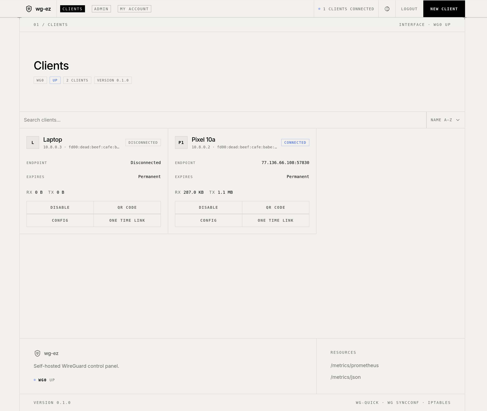

<p align="center">
  
</p>

<h1 align="center">wg-ez</h1>

<p align="center">
  WireGuard server + Web UI + offline CLI in one static binary.
</p>

<p align="center">
  <a href="LICENSE"></a>
  
  <a href="https://ghcr.io/wg-ez/wg-ez"></a>
  
</p>

<p align="center">
  
</p>

## Quick start

```yaml
# docker-compose.yml
services:
  wg-ez:
    image: ghcr.io/wg-ez/wg-ez:latest
    container_name: wg-ez
    ports:
      - 51821:51821 # Web UI
      - 51820:51820/udp # WireGuard traffic
    volumes:
      - ./wg-data:/etc/wireguard
      - /lib/modules:/lib/modules:ro
    cap_add:
      - NET_ADMIN
      - SYS_MODULE
    sysctls:
      net.ipv4.ip_forward: 1
      net.ipv6.conf.all.forwarding: 1
    restart: unless-stopped

networks:
  default:
    enable_ipv6: true
```

## Docs

- [Setup & rescue](docs/setup.md) — options, reverse proxy, password reset
- [Development](docs/development.md) — build, tests, audit

## License

MIT — see [LICENSE](LICENSE).
